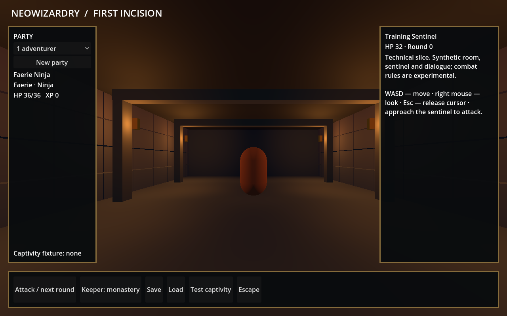

# NeoWizardry

Improved Wizardry 8 remake research project. **This is a technical slice, not a recreated monastery or a complete RPG.**

Godot 4.5.1 .NET client + independent .NET 8 core + dependency-free Python 3.10+ asset tools.



## What works

- Read-only SLF index, SHA-256 inventory and selective extraction, verified against an original Steam `DATA.SLF` containing 3314 entries.
- A catalog of 819 original item records: IDs, names, item type/icon indices and equipment restriction masks. Generated catalogs stay local; original assets are not bundled.
- A synthetic 3D corridor with free movement, collisions, mouse look, party size 1–8, a training sentinel, round resolution, XP, sample dialogue and save/load.
- A solo captivity/escape regression fixture. This proves an engine state transition, **not** that the original Crock quest has been reproduced.
- Prototype magic with five explicitly synthetic spells, learned IDs, Fire/Divine mana, power/cost previews, round integration and saved roll continuation. Original magic formulas are still research.
- Deterministic core transitions and versioned saves, tested independently of Godot. Imported melee damage dice and weapon initiative are active; the prototype RNG state survives saves.
- Original-item browser with search, raw weapon statistics and a melee equipment slot backed by the shared party bag enforcing race/profession/gender restrictions. Equipped items survive saves; loading requires the same source item database.
- Ordinary resource overlay: loose data files, then descending `PATCH.NNN`, then base archive, with source provenance.

Combat numbers and starting characters are **experimental placeholders**, not recovered Wizardry 8 formulas. No enemy scaling by party size. Reward is shared between living, uncaptured heroes, so solo retains the concentration of XP.

## Windows testing

Windows is the primary manual testing target. Download the launcher ZIP from a [Windows preview release](https://github.com/Aetton/neowizardry/releases), extract it once and double-click `RunNeoWizardry.cmd`. It checks for updates, verifies the downloaded package and launches the game. Game builds live under `%LOCALAPPDATA%/NeoWizardry`; saves remain in Godot's separate user-data directory. No Godot editor or .NET SDK installation is required. See [Windows preview guide](docs/windows.md).

## Run from source

Install .NET SDK 8 and **Godot 4.5.1 .NET** (the standard Godot binary does not run C#). From the repository root:

```sh
python -m unittest discover -s tests -v
dotnet run --project core-checks
dotnet build client/NeoWizardry.csproj
godot --path client
```

Replace `godot` with the path to your Godot .NET executable if it is not in PATH.

WASD moves; hold the right mouse button to look; Esc releases the cursor. Approach the sentinel and press **Attack / next round**. Open **Menu** for party size, **New party**, **Save/Load** and test-scenario controls. Click a side portrait to select the actor used by Magic, Items and Craft. **Save/Load** preserves the party, battle, captivity and camera. **Test captivity/Escape** demonstrates the solo regression fixture. The keeper's fixed line is sample text, not extracted story content.

```sh
godot --headless --path client -- --smoke
```

The smoke check intentionally writes `prototype-save.json` into Godot's user data directory. Do not use it as a real campaign save.

New expeditions receive a limited **test** starter bag; the training sentinel drops one configured test item on victory. These are not original starting equipment or loot tables. In **Items**, owned items are shown by default; **Browse full catalog** is inspection only and cannot grant unowned weapons. Old saves retain equipped copies but do not receive a retroactive starter bag.

New test parties can use **Magic** near the sentinel. Test Spark damages it; Test Mend heals an injured living party member. Casting replaces one hero's weapon attack for the round. Powers 1–3, costs and effects are fixtures; see [magic coverage](docs/magic.md). Existing saves do not receive retroactive learned spells or mana. Test Ward, Bind and Burn add protection, action skipping and timed damage. Queue one order per caster and resolve them together in one round.

New public-fixture parties can also use **Craft**: herbs and a vial make a test tonic; combine it with the unequipped test staff to make a tempered staff. The window shows quantities and skill gates. These recipes apply only to the synthetic catalog; see [crafting coverage](docs/crafting.md). Start a new party for test ingredients and recipe knowledge.

## Import your installation

No originals, full exported databases or copyrighted textures belong in this repository. Put local outputs in the ignored `local/` directory.

```sh
python -m tools.slf audit "/path/to/Steam/steamapps/common/Wizardry8" --out local/installation-audit.json
python -m tools.slf index "/path/to/Wizardry8/Data/DATA.SLF" --out local/data-index.json
python -m tools.slf items "/path/to/Wizardry8/Data/DATA.SLF" --out local/items.json
python -m tools.slf extract "/path/to/Wizardry8/Data/DATA.SLF" --pattern "DATABASES/*" --out local/extracted
```

Windows PowerShell uses the same commands, with your Windows installation path. Do not run extraction twice into the same destination: existing files are deliberately protected.

For the supplied Steam installation, include its enabled patch:

```sh
python -m tools.slf items "/path/to/Wizardry8/Data/DATA.SLF" --patch "/path/to/Wizardry8/Patches/PATCH.001" --out local/items.json
```

Repeat `--patch` for every enabled `PATCH.NNN`; do not pass disabled `.BAK` files. Use `--loose-dir "/path/to/Wizardry8/Data"` to include loose-file overrides. Open **Items** in the client; `local/items.json` loads automatically. An external catalog can be selected with `godot --path client -- --catalog "/path/to/items.json"`. The shared party bag tracks quantities and equipment ownership. Transfer a weapon by returning it to the bag and equipping it on another eligible hero. Items now selects individual spare copies and supports stack split/merge. Identity, quantity, identification, resource counters and equipment locations survive saves. Core resource spending is supported; use effects, recharge, curse removal and full original combat remain open. Schema-1/2 prototype saves migrate to game schema 3 on load; missing historical charge counters become zero. Assigned melee weapons now use their imported base damage dice and initiative in the experimental battle.

`audit` reads SLF files and `PATCH.NNN` locally and produces a small inventory. The Drive connector cannot download `LEVELS.SLF` because its 497,064,244 bytes exceed the connector's 256 MiB limit. Local indexing avoids that restriction. Parallel Worlds and localization overlays remain unsupported.

## Original spell reference

Export a private metadata catalog from your installation (include all enabled patches and loose overrides as for items):

```sh
python -m tools.slf spells "/path/to/Wizardry8/Data/DATA.SLF" --patch "/path/to/Wizardry8/Patches/PATCH.001" --out local/spells.json
godot --path client -- --spells local/spells.json --grimoire
```

The source client detects `local/spells.json`; packaged builds also accept `spells.json` in Godot's user-data directory, or an explicit `--spells` path. Open **Menu → Spell reference**. Public previews include only a clearly labeled synthetic entry. Reference metadata does not teach spells or enable canonical casting. See [format evidence and limits](docs/spell-format.md).

## Original combination reference

```sh
python -m tools.slf recipes "/path/to/Wizardry8/Data/DATA.SLF" --patch "/path/to/Wizardry8/Patches/PATCH.001" --out local/recipes.json
```

Open **Menu → Combination reference** after importing. The source client detects `local/recipes.json`; exported builds accept `user://recipes.json` or an explicit path:

```sh
godot --path client -- --recipes local/recipes.json --combinations
```

Search by result or ingredient name; flagged entries are hidden by default. Public previews contain one invented combination reference only. The recovered native batch/identification/skill calculation is tested separately from the shared-bag fixture: native instance creation and inventory integration remain open. See [format evidence and unresolved behavior](docs/recipe-format.md).

## Next gates

1. Obtain and validate the real `LEVELS.SLF` directory, then decode PVL geometry and collisions.
2. Extend the verified ordinary patch/loose overlay to localization and special installation layouts; identify the executable baseline.
3. Recover canonical combat/race/class/skill formulas; replace experimental rules only with evidence and regression checks.
4. Reconstruct the real monastery, NPC dialogue and Crock event; validate solo without altering its late-game strength.
5. Replace the temporary gold frame with the planned Wizardry visual identity and Grimrock-inspired materials/lighting.

See [format report](docs/formats.md), [architecture](docs/architecture.md) and [iteration report](docs/iteration-001.md).
Latest progress: [iteration 031](docs/iteration-031.md). Archive/code review: [audit 2026-10-15](docs/audit-2026-10-15.md). Native item data: [slot layout, quantities and charges](docs/item-instance-format.md). Desktop HUD: [original-layout interface](docs/interface.md).
Mobile prototype: [touch controls, Android build and device checklist](docs/mobile.md). Preview on desktop with `godot --path client -- --touch`.

Original [physical](docs/original-combat-formulas.md) and [magic](docs/original-magic-formulas.md) formula subsets are implemented independently of the experimental battle. Physical coverage includes attack budgets, per-attack swing allocation for the common melee/projectile path, weapon adjustments, attack-mode modifiers, ordinary character scores, primary-hand bonuses and [physical damage with neutral melee composition](docs/original-physical-damage.md). Full canonical combat is still in reconstruction. The older [guide model](docs/formula-sources.md) remains a source comparison.
